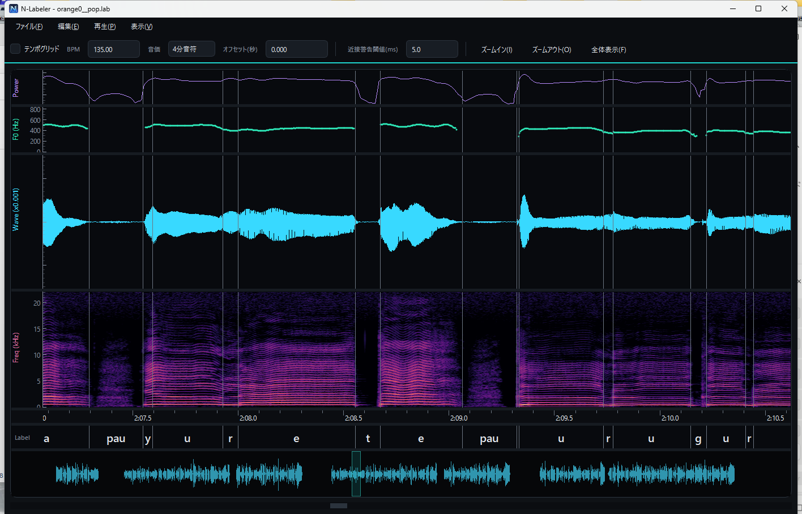

# N-Labeler

**A monophone label editor for NNSVS / singing voice databases**

A Windows desktop app for editing phoneme boundaries in `.lab` files (HTK format)
by mouse, while viewing the waveform, spectrogram, F0 and power on a synchronized
time axis.

[English](README.en.md) · [日本語](README.md)

---

## Download / Install

1. Download `N-Labeler-x.y.z-win64.zip` from [**Releases**](../../releases/latest)
2. Extract it anywhere
3. Run `N-Labeler/N-Labeler.exe`

No Python installation is required (it runs standalone).

> The build is unsigned, so Windows SmartScreen may warn you on first launch.
> Click **More info** → **Run anyway** to start it.

**Requirements:** Windows 10 / 11 (64-bit)

## Features

- **Multi-pane synchronized view** — power / F0 (VUV) / waveform / spectrogram /
  time ruler / labels / overview, all locked to one time axis. Scroll horizontally
  with the wheel, zoom with Ctrl+wheel or buttons.
- **Boundary editing** — drag boundaries on the label pane (clamped to neighbors),
  add/remove them via double-click or the right-click menu. Edited boundaries are
  shown with a distinct color and a ▼ marker. Ctrl+left-click warps the nearest
  boundary; Ctrl+drag on a boundary shifts all following labels together (handy for
  fixing head-alignment drift).
- **Cutting (adding boundaries)** — four ways: double-click, **Shift+click (knife
  mode)**, the **K key**, or the right-click menu. K cuts at the mouse cursor (or at
  the playhead during playback), so you can cut while listening. **After cut** on
  the toolbar chooses whether the left or right half's name opens for editing.
  **Auto-scroll** moves the view forward when you cut (**On cut**) or when you
  confirm the name with Enter (**On Enter**), so you can keep labeling without
  scrolling by hand.
- **Deleting boundaries** — **Alt+click**. While Alt is held you are in eraser mode
  (× cursor) and can delete a boundary with one click in any pane (clicking away from
  a boundary does nothing). The right-click menu works too.
- **Fast label entry** — while editing a name, **Tab / Shift+Tab** moves to the
  next / previous label (the text is pre-selected, so you can just type over it).
- **Entering several labels at once** — drag on the label pane (or use Shift+←→)
  to select several segments, press **Enter**, and type something like
  `ありがとう` or `a ri ga to u`. It is split into phonemes and assigned in order
  from the first segment (kana, romaji and phoneme names are accepted; one Undo
  reverts it). Press Space to play just the selected range.
- **Segment list** — **View → Segment List** (Ctrl+L) shows a table of every
  segment's start, end, length and label (hidden by default). Row selection is
  linked both ways with the panes, and you can type straight into the label column
  to edit it (Tab moves to the next row).
- **Label-name presets** — assign common phonemes (`pau`, `cl`, `GlottalStop`,
  `Edge`, …) with one click from the right-click menu. Presets are fully editable.
- **Spectrogram settings** — change FFT size / window function / dynamic range /
  upper frequency / colormap (magma / inferno / viridis / jet / grayscale) from the
  right-click menu. Zooming in recomputes only the visible range at high resolution
  in real time.
- **Playback** — Space to play/stop, play a selected range or a single label
  segment, with a real-time playhead.
- **Tempo grid** — display a grid from BPM / note value / offset. If a `.ust` with
  the same name exists, the tempo is picked up automatically.
- **Automatic label generation** — opening a `.wav` without a `.lab` can auto-draft
  phoneme labels using the bundled inference model (boundary detection + phoneme
  recognition). The result is loaded unsaved; press Ctrl+S to write the `.lab`.
- **Close-boundary warning** — boundaries closer than a threshold are highlighted
  in red.
- **Work-state saving** — edited flags, view range and tempo settings are saved to
  a `.work` file and restored next time. Analysis results (F0 / spectrogram) are
  cached to avoid recomputation.
- **Undo/Redo** (Ctrl+Z / Ctrl+Y), dark / light theme, drag-resizable pane heights.
- **Multilingual UI** — 日本語 / English / 简体中文 (View → Language; takes effect
  after restart).

## Usage

1. **File → Open** (Ctrl+O) and pick a `.lab` or `.wav`. A `.wav`/`.lab` pair with
   the same name is loaded together automatically (you can also drag & drop a
   `.lab`/`.wav` onto the app, or pass it as a launch argument).
2. Click the waveform or spectrogram to place the playback start (magenta vertical
   line), then press **Space** to play.
3. Drag boundaries on the label pane to adjust them. Add a boundary with
   double-click / Shift+click / K, delete one with **Alt+click**. The right-click
   menu can also add/remove boundaries and rename labels.
4. Double-click a label to edit its name. Press **Tab** to move on to the next label
   as you type. Select several labels and press **Enter** to fill them in at once.
5. Press **Ctrl+S** to save in place.

### Key shortcuts

| Key | Action |
|---|---|
| Space | Play / Stop |
| Ctrl+O | Open |
| Ctrl+S / Ctrl+Shift+S | Save / Save As |
| Ctrl+Z / Ctrl+Y | Undo / Redo |
| Ctrl + `+` / `-` / `0` | Zoom in / out / fit |
| ← / → , ↑ / ↓ | Move the segment selection / nudge its right boundary |
| Shift+← / → | Extend / shrink the segment selection |
| Enter | Edit the selected label's name (enter several at once when multiple are selected) |
| Ctrl+L | Show / hide the segment list |
| K | Add a boundary at the mouse (or at the playhead during playback) |
| Shift+click | Add a boundary at the click position (knife) |
| Alt+click | Delete the clicked boundary (eraser) |
| Tab / Shift+Tab | Next / previous label while editing a name |
| Wheel / Ctrl+Wheel | Horizontal scroll / Zoom |
| F1 | Show the manual |

## Label format

Reads and writes HTK-style `.lab` files (`start end phoneme`, space-separated,
times as integers in 100 ns units). Boundary continuity is validated on load and
any discontinuity is reported.

## License

The application itself is under the [MIT License](LICENSE). The distributed build
bundles PySide6 (Qt) / NumPy / SciPy / soundfile (libsndfile) / sounddevice
(PortAudio) / pyqtgraph / pyworld (WORLD) / ONNX Runtime; see
[THIRD_PARTY_LICENSES.md](THIRD_PARTY_LICENSES.md) and [`licenses/`](licenses/) for
their respective licenses. Qt and libsndfile are provided under the LGPL.
