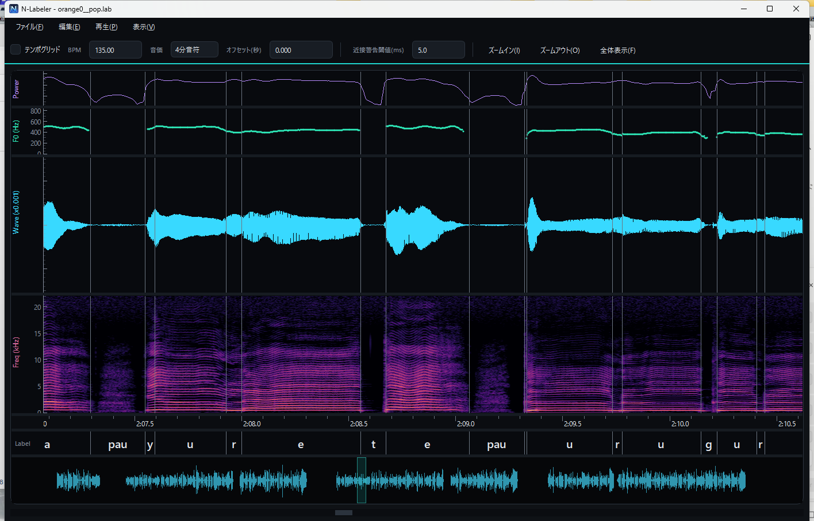

# N-Labeler

**NNSVS / 歌唱データベース向け モノフォンラベル編集ツール**

波形・スペクトログラム・F0・パワーを同期表示しながら、`.lab`（HTK形式）の
音素境界をマウスで直感的に編集できる Windows デスクトップアプリです。

---

## ダウンロード / インストール

1. [**Releases**](../../releases/latest) から `N-Labeler-x.y.z-win64.zip` をダウンロード
2. 任意の場所に展開
3. `N-Labeler/N-Labeler.exe` を起動

Python のインストールは不要です（単独で動作）。

> 署名なしのため、初回起動時に SmartScreen の警告が出ることがあります。
> 「詳細情報」→「実行」で起動できます。

**動作環境:** Windows 10 / 11（64bit）

## 特長

- **マルチペイン同期表示** — パワー / F0(VUV) / 波形 / スペクトログラム / 時間軸 /
  ラベル / オーバービューを1つの時間軸で同期。ホイールで横スクロール、
  Ctrl+ホイールやボタンでズーム。
- **境界編集** — ラベルペイン上でドラッグして境界を移動（隣接境界でクランプ）、
  ダブルクリックや右クリックメニューで追加/削除。編集済み境界は色と▼マーカーで表示。
  Ctrl+左クリックで最寄り境界をワープ、Ctrl+境界ドラッグで後続ラベルを丸ごと追従移動
  （頭出しずれの修正用）。
- **ラベル名プリセット** — よく使う音素（`pau` `cl` `GlottalStop` `Edge` …）を
  右クリックからワンクリックで割り当て。プリセットは自由に登録可能。
- **スペクトログラム設定** — FFTサイズ / 窓関数 / ダイナミックレンジ / 上限周波数 /
  カラーマップ（magma / inferno / viridis / jet / グレー）を右クリックから変更。
  ズームインすると表示範囲だけリアルタイムに高解像度で再計算。
- **再生** — Space で再生/停止、範囲選択やラベルセグメント単位の再生、
  再生ヘッドのリアルタイム追従。
- **テンポグリッド** — BPM・音価・オフセット指定でグリッド表示。同名の `.ust` が
  あればテンポを自動取得。
- **ラベル自動生成** — `.lab` の無い `.wav` を開くと、同梱の推論モデル
  （境界検出 + 音素認識）で音素ラベルの下書きを自動生成できます
  （結果は未保存状態で読み込まれ、Ctrl+S で `.lab` に保存）。
- **近接境界警告** — 閾値以内に近づいた境界を赤く強調。
- **作業状態の保存** — 編集済みフラグ・表示範囲・テンポ設定を `.work` に保存し
  次回自動復元。分析結果（F0/スペクトログラム）はキャッシュして再計算を回避。
- **Undo/Redo**（Ctrl+Z / Ctrl+Y）、ダーク / ライトテーマ、ペイン高さのドラッグ調整。

## 使い方

1. **ファイル → 開く**（Ctrl+O）で `.lab` か `.wav` を選択。
   同名の `.wav`/`.lab` は自動でペア読み込みされます（`.lab`/`.wav` をアプリに
   ドラッグ＆ドロップ、または引数起動も可）。
2. 波形やスペクトログラムをクリックして再生開始位置（マゼンタの縦線）を置き、
   **Space** で再生。
3. ラベルペイン上で境界をドラッグして調整。ダブルクリックで境界追加、
   右クリックで追加/削除・ラベル名変更。
4. **Ctrl+S** で上書き保存。

### 主なショートカット

| キー | 機能 |
|---|---|
| Space | 再生 / 停止 |
| Ctrl+O | 開く |
| Ctrl+S / Ctrl+Shift+S | 上書き保存 / 別名保存 |
| Ctrl+Z / Ctrl+Y | 元に戻す / やり直す |
| Ctrl + `+` / `-` / `0` | ズームイン / アウト / 全体表示 |
| ホイール / Ctrl+ホイール | 横スクロール / ズーム |
| F1 | 操作マニュアルを表示 |

## ラベルフォーマット

HTK形式の `.lab`（`開始 終了 音素` を空白区切り、時刻は 100ns 単位の整数）を
読み書きします。読み込み時に境界の連続性を検証し、不連続があれば警告します。

## ライセンス

本体は [MIT ライセンス](LICENSE)。配布ビルドには PySide6(Qt) / NumPy / SciPy /
soundfile(libsndfile) / sounddevice(PortAudio) / pyqtgraph / pyworld(WORLD) /
ONNX Runtime を同梱しており、それぞれのライセンスは [THIRD_PARTY_LICENSES.md](THIRD_PARTY_LICENSES.md)
および [`licenses/`](licenses/) を参照してください。Qt および libsndfile は
LGPL で提供されています。
